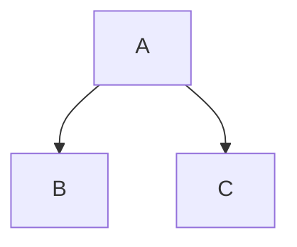

# Практическая работа №2

Вариант 8.

Инструмент визуализации графа зависимостей npm-пакетов.

## Язык реализации

Python 3.12.

Для основной логики используются только средства стандартной
библиотеки Python. Готовые средства npm и библиотеки для построения
графа зависимостей не используются.

## Назначение программы

Программа анализирует зависимости npm-пакетов и строит
транзитивный граф зависимостей.

Реализованы все пять этапов практической работы:

1. Конфигурация через командную строку.
2. Получение прямых зависимостей npm.
3. Построение транзитивного графа рекурсивным DFS.
4. Поиск обратных зависимостей.
5. Формирование текстового графа в формате Mermaid.

Дополнительно реализована генерация автономных SVG-изображений
для тестовых JSON-графов. SVG используется только как наглядное
представление результата и не заменяет обязательный Mermaid-вывод.

## Структура проекта

```text
2_practice/
│
├── src/
│   ├── main.py
│   ├── config.py
│   ├── npm_client.py
│   ├── semver.py
│   ├── graph_builder.py
│   ├── test_repository.py
│   ├── reverse_dependencies.py
│   ├── mermaid.py
│   ├── svg_renderer.py
│   └── generate_diagrams.py
│
├── tests/
│   ├── test_config.py
│   ├── test_npm_client.py
│   ├── test_graph_builder.py
│   ├── test_semver.py
│   ├── test_reverse_dependencies.py
│   ├── test_mermaid.py
│   └── test_svg_renderer.py
│
├── test_data/
│   ├── simple.json
│   ├── cycle.json
│   ├── depth.json
│   └── reverse.json
│
├── diagrams/
│   ├── simple.svg
│   ├── cycle.svg
│   ├── depth.svg
│   └── reverse.svg
│
├── README.md
└── run.bat
```

## Этап 1. Конфигурация

Параметры программы передаются через командную строку.

| Параметр | Обязательный | Назначение |
| --- | --- | --- |
| `--package` | да | Имя анализируемого npm-пакета или тестовой вершины |
| `--repository` | да | URL npm Registry или путь к JSON-файлу |
| `--test-mode` | нет | Включает локальный тестовый режим |
| `--version` | да | Версия исходного npm-пакета |
| `--max-depth` | нет | Максимальная глубина DFS, по умолчанию 3 |

В тестовом режиме имя пакета должно состоять из заглавных
латинских букв, а путь в `--repository` должен указывать на
существующий файл.

В обычном режиме `--repository` должен быть корректным HTTP
или HTTPS URL.

Пример:

```bat
python src\main.py --package express --repository https://registry.npmjs.org --version 4.18.2 --max-depth 1
```

То же самое через точку запуска Windows:

```bat
run.bat --package express --repository https://registry.npmjs.org --version 4.18.2 --max-depth 1
```

## Этап 2. Получение прямых зависимостей

Программа самостоятельно обращается к npm Registry через HTTP:

1. Формирует URL пакета.
2. Получает JSON-метаданные.
3. Извлекает поле `dependencies`.
4. Получает прямые зависимости указанной версии.

Готовые средства npm для получения графа зависимостей не
используются.

## Этап 3. Транзитивный граф

Для построения транзитивного графа используется рекурсивный DFS.

Например:

```text
A
├── B
│   └── D
└── C
    └── E
```

DFS сначала проходит в глубину по одной ветке, затем
возвращается к предыдущей вершине.

### Ограничение глубины

Корень имеет глубину 0. Его прямые зависимости находятся на
глубине 1, зависимости этих пакетов — на глубине 2 и так далее.

Параметр `--max-depth` запрещает дальнейший спуск после
достижения указанной глубины.

### Циклы

Для текущего пути обхода используется множество `active`.
Если следующая вершина уже находится в текущем пути, ребро
сохраняется, но повторный рекурсивный вызов не выполняется.

Например:

```text
A -> B -> C -> A
```

поэтому бесконечной рекурсии не возникает.

Множество глубин `visited_depth` дополнительно не позволяет
повторно обрабатывать вершину на той же или большей глубине.

## Тестовый режим

В тестовом режиме вместо npm Registry используется локальный
JSON-файл.

Формат:

```json
{
    "A": ["B", "C"],
    "B": ["D"],
    "C": [],
    "D": []
}
```

Пример запуска:

```bat
python src\main.py --package A --repository test_data\simple.json --test-mode --version 1.0.0 --max-depth 3
```

Файлы тестовых графов:

- `simple.json` — обычный разветвлённый граф;
- `cycle.json` — цикл;
- `depth.json` — длинная цепочка для проверки глубины;
- `reverse.json` — граф для проверки обратных зависимостей.

## Этап 4. Обратные зависимости

Обратные зависимости показывают не то, от чего зависит пакет,
а какие пакеты зависят от него.

Пример:

```text
A -> B -> D
C -> D
```

Для `D` обратными зависимостями являются `A`, `B` и `C`.

Реализация перебирает вершины тестового репозитория, строит
для каждой вершины граф уже реализованным DFS и проверяет
достижимость целевого пакета.

## Этап 5. Mermaid

Финальный этап преобразует построенный граф в текстовое
представление Mermaid.

Пример:



Внутренние идентификаторы `n0`, `n1` и так далее нужны,
чтобы специальные символы в именах настоящих npm-пакетов не
ломали синтаксис Mermaid.

## SVG-визуализация

Для демонстрации на защите дополнительно реализовано создание
автономных SVG-файлов без сторонних библиотек.

Команда:

```bat
python src\generate_diagrams.py
```

создаёт или обновляет:

```text
diagrams\simple.svg
diagrams\cycle.svg
diagrams\depth.svg
diagrams\reverse.svg
```

SVG является текстовым XML-документом и открывается напрямую
в Chrome, Edge и других современных браузерах.

Готовые изображения:

- [simple.svg](diagrams/simple.svg)
- [cycle.svg](diagrams/cycle.svg)
- [depth.svg](diagrams/depth.svg)
- [reverse.svg](diagrams/reverse.svg)

## Визуализация трёх npm-пакетов

### Express

```bat
python src\main.py --package express --repository https://registry.npmjs.org --version 4.18.2 --max-depth 1
```

### Debug

```bat
python src\main.py --package debug --repository https://registry.npmjs.org --version 4.3.4 --max-depth 1
```

### Accepts

```bat
python src\main.py --package accepts --repository https://registry.npmjs.org --version 1.3.8 --max-depth 1
```

Во всех трёх случаях программа получает данные из npm Registry
и печатает Mermaid-описание графа.

## Сравнение со штатным npm

Для сравнения результата можно создать отдельный временный
npm-проект:

```bat
mkdir npm_compare
cd npm_compare
npm init -y
npm install express@4.18.2
npm ls --all
```

`npm ls --all` используется только для сравнения. Основная
программа не запускает npm для получения зависимостей.

Наша реализация строит логический граф на основании метаданных
Registry и заданной глубины. npm показывает фактически
разрешённое дерево установленного проекта и может выполнять
дедупликацию.

## Все функции, классы и настройки

Ниже перечислены функции и классы исходного кода `src`.
Функции с именем, начинающимся с `_`, являются внутренними
вспомогательными функциями модуля.

### `config.py`

| Элемент | Назначение |
| --- | --- |
| `Config` | Dataclass с итоговыми настройками программы |
| `positive_depth(value)` | Проверяет и преобразует максимальную глубину |
| `build_parser()` | Создаёт и настраивает `ArgumentParser` |
| `_clean_values(options)` | Удаляет внешние пробелы из строковых параметров |
| `_validate_required(...)` | Проверяет обязательные непустые значения |
| `_validate_test_mode(...)` | Проверяет файл и имя пакета тестового режима |
| `_validate_url(...)` | Проверяет HTTP/HTTPS URL репозитория |
| `parse_config(args=None)` | Разбирает аргументы, выполняет валидацию и возвращает `Config` |

Поля `Config`: `package`, `repository`, `test_mode`,
`version`, `max_depth`.

Константы: `DEFAULT_MAX_DEPTH`, `MIN_DEPTH`,
`HTTP_SCHEMES`.

### `npm_client.py`

| Элемент | Назначение |
| --- | --- |
| `NpmClientError` | Исключение ошибок доступа к npm Registry |
| `build_package_url(...)` | Формирует URL пакета или конкретной версии |
| `load_json(url)` | Выполняет HTTP-запрос и разбирает JSON |
| `fetch_package_metadata(...)` | Получает метаданные конкретной версии |
| `fetch_package_document(...)` | Получает документ со всеми версиями пакета |
| `resolve_version(...)` | Выбирает конкретную версию для диапазона |
| `get_dependencies(...)` | Возвращает прямые зависимости версии |
| `get_dependencies_for_range(...)` | Возвращает выбранную версию и её зависимости |

HTTP выполняется через `urllib.request`, JSON разбирается
модулем `json`.

### `semver.py`

| Функция | Назначение |
| --- | --- |
| `parse_version(version)` | Преобразует `x.y.z` в кортеж чисел |
| `satisfies_caret(...)` | Проверяет диапазон вида `^1.2.3` |
| `satisfies_tilde(...)` | Проверяет диапазон вида `~1.2.3` |
| `satisfies(...)` | Проверяет точную, caret- или tilde-версию |
| `choose_version(...)` | Выбирает максимальную подходящую версию |

Константы: `SEMVER_PARTS`, `ZERO`.

Реализация предназначена для учебной работы и поддерживает
точные версии, `^` и `~`. Полный синтаксис npm semver
не реализуется.

### `graph_builder.py`

| Элемент | Назначение |
| --- | --- |
| `NpmGraphBuilder.__init__(...)` | Инициализирует граф и состояние обхода |
| `NpmGraphBuilder.build(...)` | Запускает DFS от исходного пакета |
| `NpmGraphBuilder._load_dependencies(...)` | Получает версию и зависимости вершины |
| `NpmGraphBuilder._should_skip(...)` | Проверяет повторное посещение по глубине |
| `NpmGraphBuilder._add_edges(...)` | Добавляет рёбра в словарь графа |
| `NpmGraphBuilder._dfs(...)` | Выполняет основной рекурсивный DFS |
| `NpmGraphBuilder._visit_children(...)` | Рекурсивно посещает дочерние вершины |
| `build_npm_graph(...)` | Создаёт строитель и возвращает граф с версиями |

Основные структуры состояния: `graph`, `versions`,
`visited_depth`, `active`.

### `test_repository.py`

| Элемент | Назначение |
| --- | --- |
| `TestRepositoryError` | Исключение ошибок тестового репозитория |
| `validate_package(name)` | Проверяет имя вершины по шаблону A-Z |
| `load_test_repository(path)` | Читает JSON и проверяет его структуру |
| `_validate_dependencies(...)` | Проверяет список зависимостей вершины |
| `validate_graph(graph)` | Проверяет весь тестовый граф |
| `TestGraphBuilder.__init__(...)` | Инициализирует состояние тестового DFS |
| `TestGraphBuilder.build(start)` | Запускает обход от стартовой вершины |
| `TestGraphBuilder._should_skip(...)` | Проверяет повторное посещение |
| `TestGraphBuilder._dfs(...)` | Выполняет рекурсивный DFS тестового графа |
| `TestGraphBuilder._visit_children(...)` | Обрабатывает дочерние вершины |
| `build_test_graph(...)` | Создаёт строитель и возвращает тестовый граф |

Константа `PACKAGE_PATTERN` задаёт формат имён тестовых
пакетов.

### `reverse_dependencies.py`

| Функция | Назначение |
| --- | --- |
| `find_reverse_dependencies(...)` | Находит все пакеты, из которых достижим целевой пакет |

Функция использует `build_test_graph()`, поэтому повторно
использует DFS предыдущего этапа.

### `mermaid.py`

| Функция | Назначение |
| --- | --- |
| `escape_label(value)` | Экранирует подпись вершины |
| `collect_nodes(graph)` | Собирает все вершины графа |
| `_build_node_ids(nodes)` | Создаёт безопасные ID вида `n0` |
| `_make_label(...)` | Формирует отображаемую подпись |
| `_build_node_lines(...)` | Формирует строки объявления вершин |
| `_build_edge_lines(...)` | Формирует строки рёбер |
| `graph_to_mermaid(...)` | Собирает полное Mermaid-описание |

### `svg_renderer.py`

| Функция | Назначение |
| --- | --- |
| `collect_nodes(graph)` | Собирает и сортирует вершины |
| `_indegrees(...)` | Считает количество входящих рёбер |
| `_fill_levels(...)` | Заполняет уровни для размещения вершин |
| `_assign_levels(...)` | Назначает уровень каждой вершине |
| `_group_levels(...)` | Группирует вершины по уровням |
| `_positions(levels)` | Вычисляет координаты вершин |
| `_canvas_height(levels)` | Вычисляет высоту SVG |
| `_forward_path(...)` | Строит путь обычного направленного ребра |
| `_back_path(...)` | Строит дугу обратного или циклического ребра |
| `_edge_path(...)` | Выбирает тип SVG-пути |
| `_edge_lines(...)` | Формирует SVG для всех рёбер |
| `_node_lines(...)` | Формирует SVG для всех вершин |
| `_svg_defs()` | Формирует определения градиента и стрелки |
| `_svg_styles()` | Формирует CSS-стили SVG |
| `_svg_opening(...)` | Формирует открывающие элементы SVG |
| `_header(...)` | Собирает начало SVG-документа |
| `graph_to_svg(...)` | Возвращает полный автономный SVG |

Настройки визуализации заданы константами:
`CANVAS_WIDTH`, `TOP_MARGIN`, `BOTTOM_MARGIN`,
`SIDE_MARGIN`, `LEVEL_GAP`, `NODE_WIDTH`,
`NODE_HEIGHT`, `NODE_RADIUS`, `FONT_SIZE`,
`EDGE_WIDTH`, `BACK_EDGE_OFFSET`, `ROOT_LEVEL`.

### `generate_diagrams.py`

| Функция | Назначение |
| --- | --- |
| `generate_diagram(file_name)` | Читает один JSON и сохраняет соответствующий SVG |
| `main()` | Генерирует SVG для всех тестовых JSON |

Константы `ROOT`, `TEST_DATA`, `OUTPUT` задают каталоги,
а `JSON_FILES` — список демонстрационных графов.

### `main.py`

| Функция | Назначение |
| --- | --- |
| `print_mermaid(...)` | Печатает Mermaid-представление |
| `run_test_mode(config)` | Запускает построение локального тестового графа |
| `run_npm_mode(config)` | Запускает построение реального npm-графа |
| `main()` | Разбирает конфигурацию, выбирает режим и возвращает код завершения |

## Тесты

Запуск из каталога `2_practice`:

```bat
python -m unittest discover -s tests -v
```

Тесты проверяют:

- параметры командной строки;
- формирование URL npm;
- извлечение прямых зависимостей;
- обработку диапазонов версий;
- транзитивный DFS;
- ограничение глубины;
- циклы;
- отсутствие стартовой вершины;
- обратные зависимости;
- Mermaid;
- SVG.

Успешное выполнение заканчивается сообщением:

```text
OK
```

GitHub Actions автоматически запускает тесты первой и второй
практической работы при push в основные рабочие ветки и при
pull request в `main`.

## Ограничения реализации

Поддержка npm semver намеренно упрощена до точных версий,
caret (`^`) и tilde (`~`). Диапазоны `>=`, `<=`, `||`,
`*`, теги, Git URL, workspace и другие расширенные варианты
не реализованы.

Граф хранит вершины по имени пакета, поэтому учебная реализация
не предназначена для одновременного представления нескольких
разных версий одного имени как отдельных вершин.

## Что показать на защите

1. Запустить `simple.json` и показать Mermaid-вывод.
2. Открыть `diagrams\simple.svg` в браузере.
3. Открыть `cycle.svg` и объяснить защиту от бесконечной рекурсии.
4. Запустить `depth.json` с ограничением глубины.
5. Открыть `reverse.svg` и объяснить обратные зависимости.
6. Запустить один реальный npm-пакет.
7. Показать успешный запуск модульных тестов.

Короткое объяснение SVG:

> Программа строит граф самостоятельно. Пятый этап выдаёт
> обязательное текстовое представление Mermaid. Дополнительно тот
> же словарь графа преобразуется средствами стандартной библиотеки
> Python в автономный SVG для наглядного просмотра в браузере.

## Итог

В работе реализованы:

- CLI-конфигурация;
- npm Registry;
- прямые зависимости;
- транзитивные зависимости;
- рекурсивный DFS;
- ограничение глубины;
- обработка циклов;
- тестовый JSON-репозиторий;
- обратные зависимости;
- Mermaid-визуализация;
- SVG-визуализация;
- модульные тесты;
- автоматический запуск тестов через GitHub Actions.
