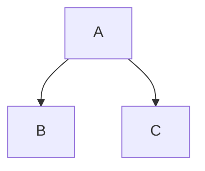

# Практическая работа №2

Вариант 8.

Инструмент визуализации графа зависимостей npm-пакетов.

## Язык реализации

Python 3.12.

Для основной логики используются только средства стандартной
библиотеки Python.

## Назначение программы

Программа анализирует зависимости npm-пакетов и строит
транзитивный граф зависимостей.

Реализованы все пять этапов практической работы:

1. Конфигурация через командную строку.
2. Получение прямых зависимостей npm.
3. Построение графа рекурсивным DFS.
4. Поиск обратных зависимостей.
5. Формирование графа в формате Mermaid.

Дополнительно реализована генерация автономных SVG-изображений
для тестовых JSON-графов. Эти файлы можно открыть напрямую
в браузере и показать на защите без Mermaid Live Editor.

## Структура проекта

```text
2_practice/
│
├── src/
│   ├── main.py
│   ├── config.py
│   ├── npm_client.py
│   ├── semver.py
│   ├── graph_builder.py
│   ├── test_repository.py
│   ├── reverse_dependencies.py
│   ├── mermaid.py
│   ├── svg_renderer.py
│   └── generate_diagrams.py
│
├── tests/
│   ├── test_config.py
│   ├── test_npm_client.py
│   ├── test_graph_builder.py
│   ├── test_semver.py
│   ├── test_reverse_dependencies.py
│   ├── test_mermaid.py
│   └── test_svg_renderer.py
│
├── test_data/
│   ├── simple.json
│   ├── cycle.json
│   ├── depth.json
│   └── reverse.json
│
├── diagrams/
│   ├── simple.svg
│   ├── cycle.svg
│   ├── depth.svg
│   └── reverse.svg
│
├── README.md
└── run.bat
```

## Этап 1. Конфигурация

Параметры программы передаются через командную строку.

Поддерживаются:

- имя анализируемого пакета;
- URL npm Registry или путь к тестовому репозиторию;
- режим тестового репозитория;
- версия пакета;
- максимальная глубина анализа.

Пример:

```bat
python src\main.py --package express --repository https://registry.npmjs.org --version 4.18.2 --max-depth 1
```

## Этап 2. Получение данных

Программа обращается к npm Registry через HTTP.

Она самостоятельно:

1. Формирует URL пакета.
2. Получает JSON.
3. Извлекает поле `dependencies`.
4. Получает прямые зависимости указанной версии.

Готовые средства npm для получения зависимостей в основной
логике программы не используются.

## Этап 3. Граф зависимостей

Для построения транзитивного графа используется рекурсивный
алгоритм DFS.

Пример:

```text
A
├── B
│   └── D
└── C
    └── E
```

DFS сначала проходит в глубину по одной ветке, после чего
возвращается назад.

### Ограничение глубины

Параметр:

```text
--max-depth
```

задаёт максимальную глубину анализа.

### Циклы

Программа корректно обрабатывает циклические зависимости.

Например:

```text
A -> B
B -> C
C -> A
```

Бесконечной рекурсии не возникает.

## Тестовый режим

Вместо npm Registry может использоваться JSON-файл.

Имена тестовых пакетов состоят из больших латинских букв.

Пример:

```json
{
    "A": ["B", "C"],
    "B": ["D"],
    "C": [],
    "D": []
}
```

Запуск:

```bat
python src\main.py --package A --repository test_data\simple.json --test-mode --version 1.0.0 --max-depth 3
```

## Этап 4. Обратные зависимости

Обратные зависимости — пакеты, которые зависят от указанного
пакета.

Например:

```text
A -> B -> D
C -> D
```

Для `D` обратными зависимостями являются:

```text
A
B
C
```

Поиск выполняется с использованием DFS предыдущего этапа.

## Этап 5. Mermaid

Финальный этап преобразует построенный граф в текстовое
представление Mermaid.

Например граф:

```text
A
├── B
└── C
```

преобразуется в:



Функция `graph_to_mermaid()` создаёт идентификаторы вершин,
подписи и связи.

## SVG-визуализация

Для защиты дополнительно добавлена генерация готовых SVG-файлов.

Команда:

```bat
python src\generate_diagrams.py
```

создаёт или обновляет:

```text
diagrams\simple.svg
diagrams\cycle.svg
diagrams\depth.svg
diagrams\reverse.svg
```

SVG-файлы являются обычными векторными изображениями. Их можно
открыть двойным щелчком в Chrome, Edge или другом браузере.

Генерация SVG не заменяет обязательный Mermaid-вывод. Mermaid
остаётся результатом пятого этапа, а SVG используется как удобное
наглядное представление того же графа.

### simple.json

Обычный разветвлённый граф:

```text
A -> B -> D
A -> C -> E
```

Готовое изображение:
[diagrams/simple.svg](diagrams/simple.svg)

### cycle.json

Граф с циклом:

```text
A -> B -> C -> A
```

Готовое изображение:
[diagrams/cycle.svg](diagrams/cycle.svg)

### depth.json

Цепочка для демонстрации ограничения глубины:

```text
A -> B -> C -> D -> E
```

Готовое изображение:
[diagrams/depth.svg](diagrams/depth.svg)

### reverse.json

Граф для проверки обратных зависимостей.

Готовое изображение:
[diagrams/reverse.svg](diagrams/reverse.svg)

## Визуализация трёх npm-пакетов

### Express

```bat
python src\main.py --package express --repository https://registry.npmjs.org --version 4.18.2 --max-depth 1
```

### Debug

```bat
python src\main.py --package debug --repository https://registry.npmjs.org --version 4.3.4 --max-depth 1
```

### Accepts

```bat
python src\main.py --package accepts --repository https://registry.npmjs.org --version 1.3.8 --max-depth 1
```

В каждом случае программа выводит описание графа Mermaid.

## Сравнение со штатным npm

Для сравнения можно создать отдельный npm-проект:

```bat
mkdir npm_compare
cd npm_compare
npm init -y
npm install express@4.18.2
npm ls --all
```

Наша программа получает информацию самостоятельно из
npm Registry.

Команда `npm ls --all` используется только для сравнения
результата после выполнения анализа.

Возможны различия между выводами.

Наша программа строит логический граф на основании метаданных
npm Registry и заданной максимальной глубины.

npm показывает дерево фактически разрешённых и установленных
версий зависимостей и может выполнять дедупликацию пакетов.

## Основные файлы

### `config.py`

Обрабатывает и проверяет параметры командной строки.

### `npm_client.py`

Получает метаданные npm-пакетов через HTTP.

### `semver.py`

Выполняет базовую обработку диапазонов npm-версий.

### `graph_builder.py`

Строит транзитивный граф зависимостей рекурсивным DFS.

### `test_repository.py`

Загружает и анализирует локальные тестовые репозитории.

### `reverse_dependencies.py`

Ищет пакеты, которые зависят от указанного пакета.

### `mermaid.py`

Преобразует граф зависимостей в описание Mermaid.

### `svg_renderer.py`

Формирует автономное SVG-изображение графа без сторонних
библиотек.

### `generate_diagrams.py`

Генерирует SVG для всех тестовых JSON-файлов.

### `main.py`

Запускает необходимый режим программы и выводит результат.

## Запуск тестов

Из папки `2_practice`:

```bat
python -m unittest discover -s tests -v
```

Успешное выполнение заканчивается сообщением:

```text
OK
```

## Запуск через run.bat

Например:

```bat
run.bat --package express --repository https://registry.npmjs.org --version 4.18.2 --max-depth 1
```

## Что показать на защите

Рекомендуемый порядок:

1. Запустить `simple.json` и показать Mermaid-вывод.
2. Открыть `diagrams\simple.svg` в браузере.
3. Открыть `cycle.svg` и объяснить обработку цикла.
4. Открыть `depth.svg` и объяснить `--max-depth`.
5. Открыть `reverse.svg` и объяснить обратные зависимости.

Если преподаватель спрашивает, откуда берётся SVG:

> Программа строит тот же граф зависимостей и дополнительно
> формирует автономное векторное SVG-представление. Mermaid остаётся
> обязательным текстовым представлением пятого этапа, а SVG нужен
> для наглядного просмотра графа в браузере.

## Итог

В работе реализован инструмент анализа зависимостей
npm-пакетов без использования готовых средств менеджера
пакетов для получения графа.

Программа поддерживает:

- конфигурацию CLI;
- npm Registry;
- прямые зависимости;
- транзитивные зависимости;
- рекурсивный DFS;
- ограничение глубины;
- обработку циклов;
- тестовый репозиторий;
- обратные зависимости;
- Mermaid-визуализацию;
- генерацию автономных SVG-диаграмм.
